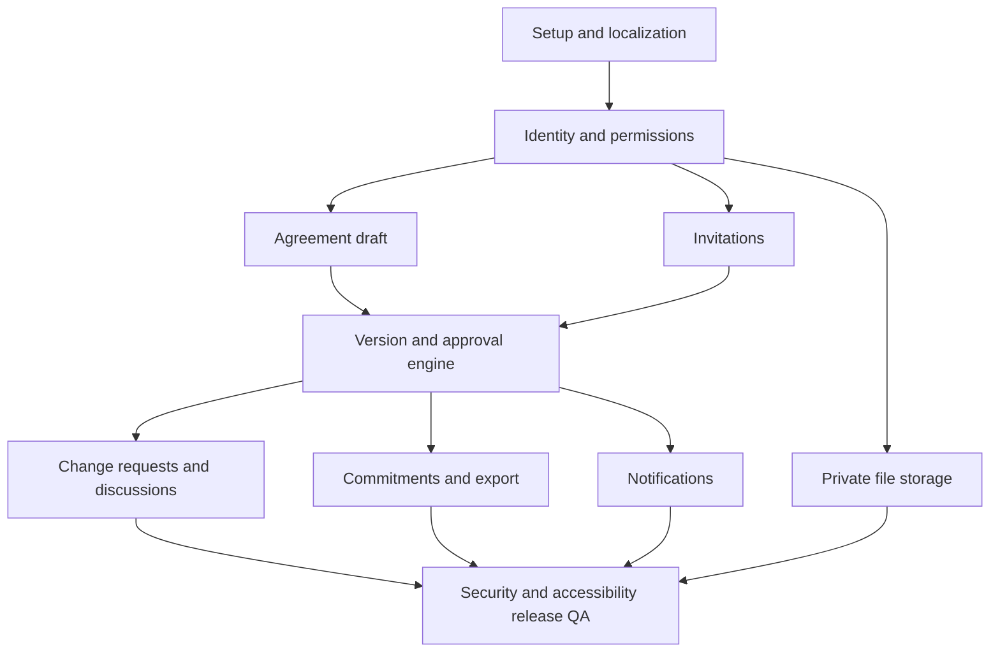

# 09 — Implementation roadmap, dependencies, and deliverables

This is **not a one-day-only project**. Prioritize a dependable cross-user collaboration product rather than maximal feature count. Suggested estimate: **12–20+ focused development days**, depending on existing components, testing and infrastructure; not a promised delivery date. Build in vertical slices with demoable exit criteria.

## Phase 0 — Project decisions and setup (Sprint 0)
**Tasks:** confirm stack, minimal branding, local dev setup; create repository structure; Prisma Postgres via Docker Compose; lint/typecheck/test scripts; next-intl Arabic/English layout; CI basics; `.env.example`, secrets policy, `AGENTS.md` adherence.
**Exit:** fresh install and `docker compose up` works; DB migrations run, AR/EN shell displays; no secret in Git.

## Phase 1 — Identity, tenancy, and agreements
### Sprint 1: identity, workspace membership and permission skeleton
- Auth.js auth and verified email; personal workspace provision and business workspace creation.
- Workspace roles; backend `canViewAgreement`, `canEditDraft`, `canInvite`, `canReview` functions with deny-by-default.
- Test user registration, email verification, session expiration, revoked membership.
**Exit:** two distinct signed-in verified accounts; no cross-user data access.

### Sprint 2: structured draft and core agreement screens
- Agreement create/list/detail/rename and structured term editor, Zod constraints, autosave or explicit save with optimistic revision.
- Draft persists to PostgreSQL; required/optional term fields; no mandatory prices/amounts.
- Organizer's own AgreementParticipant record; draft-only editing and activity trail.
**Exit:** individual + business user can create independent agreements; unauthorized updates rejected; mobile UI usable.

## Phase 2 — Multi-party collaboration and immutable agreements
### Sprint 3: invites and reviewer roster
- Invitation token generation/hashing, expiry, one-use acceptance, matching verified email, revocation/resend, role mapping.
- Add participants, detect duplicate addresses, display joined/pending state.
- Recipient access scoped to agreement.
**Exit:** second account receives invitation, joins, and can view only invited agreement; third outsider cannot.

### Sprint 4: review/approval engine (release-critical)
- Immutable frozen version snapshots with deterministic content hash and reviewer roster.
- Review decisions, request-changes, withdrawal, promotion only after all required approvals.
- Atomic locks/transactions, concurrency and stale-hash checks; current and pending version UI.
**Exit:** two-account end-to-end approve v1, amend→v2 flow, rejection without changing agreed v1; race tests pass.

### Sprint 5: change proposals and discussion
- Term-level before/after proposals, organizer accept/decline into draft, reviewer comments and version diff.
- Activity event timeline with actor/time/version links; no silent mutation of submitted review.
**Exit:** invitee suggests a change; organizer drafts it; both see before/after and explicitly approve new version.

## Phase 3 — Operationally useful first release
### Sprint 6: commitments, private attachments, notifications, export
- Commitment assignee, due date, status and `needsReview` after amendment.
- **Private server-side persistent volume** upload/download with access controls, quotas, backups and restore test.
- Invite and review notices by Resend or local fake adapter; basic notification preferences.
- Print/PDF-friendly agreement and version summary; status wording avoids legal claims.
**Exit:** full collaboration workflow + authorized file download survives Docker redeploy; unauthorized download denied; exported summary matches current agreed version.

### Sprint 7: product hardening and release
- Arabic/English copy review; responsive/accessibility/print QA; missing-state/error QA.
- E2E tests with three accounts; backup+restore rehearsal; rate limits/security controls; monitoring, log redaction, privacy and terms pages.
- Deploy single VPS with HTTPS; run release checklist.
**Exit:** acceptance matrix in `10` passes; backup and data access policy verified; pilot-ready.

## Later phases (validate demand first)
- Templates by agreement purpose, better business workspace administration, due-date notifications with background worker, richer reporting, stronger identity verification and jurisdiction-specific legal partnerships if desired.
- No legal digital signature feature without independent technical/legal scope.
- No move to distributed storage unless there is a concrete scaling requirement and migration plan.

## Sprint dependency graph

## Definition of done for every feature
- Documented acceptance scenario, server-side authorization tests, Zod schemas, UI loading/empty/error states, AR/EN translations, TypeScript/lint/test pass, no added secrets, stable migration if DB changed.
- Recorded decisions where requirements were ambiguous.
- Document what was tested vs not tested. A visually finished screen is not finished functionality.

## Suggested early demos
1. **D1:** create a personal agreement with no amount or due date.
2. **D2:** external invitation redeemed only by target verified account.
3. **D3:** two parties agree to V1, with visible content hash/version badge.
4. **D4:** a change is proposed, V2 reviewed, and V1 remains current until accepted.
5. **D5:** private file persists after app container replacement; outsider blocked.
